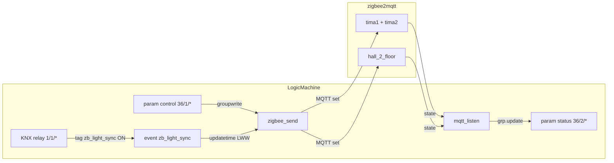

# Zigbee ceiling light params via Logic Machine — Design Spec

**Date:** 2026-11-24  
**Status:** Approved (brainstorm)  
**Scope:** Virtual LM objects + `mqtt_listen` / `zigbee_send` + event sync on KNX relay ON for brightness / color_temp / RGB of 2nd-floor Zigbee ceiling lamps.  
**Depends on:** Existing LAN zigbee2mqtt → LM (`mqtt_listen`, `zigbee_send`); KNX relay on/off for room lights unchanged.  
**Related:** `cm-client/scripts/mqtt_listen.lua`, `docs/superpowers/specs/2026-07-15-house-objects-inventory.md`, `specs/002-logicmachine-mqtt-client/`.  
**Out of scope (later):** Yandex Alice, Nord Ops / `set_lights` extensions, HA light entities for these params.

---

## 1. Problem

На 2 этаже в zigbee2mqtt есть потолочные Tuya-лампы с яркостью, CCT и RGB:

| z2m friendly name | Модель | Комната |
|-------------------|--------|---------|
| `Ceiling_lamp_tima1` | Tuya `CK-BL702-AL-01` | Тимина |
| `Ceiling_lamp_tima2` | Tuya `CK-BL702-AL-01` | Тимина |
| **группа** `Ceiling_lamps_tima` (z2m id 1) | члены: tima1+tima2 | Тимина — один MQTT `…/set` |
| `Ceiling_lamp_hall_2_floor` | Tuya `TS0505B_1` | Холл 2 этаж |
| `Ceiling_lamp_office` | Tuya `TS0505B_1` (`0xa4c1386468e80b6b`) | Кабинет |

В LM для этих зон уже есть KNX-реле on/off (`1/1/13` Тима, `1/1/15` холл, `1/1/14` кабинет). Они **работают и остаются**. В `mqtt_listen` заведены только простые Zigbee on/off (торшер, кухня, тайфайтер) — без brightness / color_temp / color. Управлять параметрами света из LM (сцены, визуализация) сейчас нельзя.

Кабинет **re-paired** в z2m как `Ceiling_lamp_office` (тот же IEEE `0xa4c1386468e80b6b`).

---

## 2. Goals

| Goal | Decision |
|------|----------|
| Не трогать реле | Пары `1/1/*` control / `1/2/*` status без изменений |
| Параметры через LM | brightness, color_temp (mired), RGB |
| Тима | Одна логическая зона → один set на группу `Ceiling_lamps_tima` |
| Feedback | status GA из z2m state |
| Питание OFF | Команда set в эфир не «ждётся» в z2m; догон при ON реле |
| Конфликт LM vs z2m UI | Last-write-wins по `updatetime` control vs status |
| Алиса / Nord / HA | Не в этой итерации |

---

## 3. Non-goals

- Замена KNX-реле Zigbee on/off.
- Отдельный Zigbee on/off GA на потолочники (питание = реле).
- Mode-GA «цвет vs CCT» (последняя запись побеждает, как в z2m).
- Очередь pending в z2m или в облаке.
- Расширение `set_lights` / MCP / Alice.
- Автопоиск лампы в mesh, если снова пропадёт (кабинет уже `Ceiling_lamp_office`).

---

## 4. Architecture

**Write while powered:** control → `zigbee_send` → `zigbee2mqtt/<friendly>/set` → state → `mqtt_listen` → status.

**Write while unpowered:** control обновляется в LM; set до устройства не доходит (лампа offline). При OFF→ON реле срабатывает sync-скрипт.

---

## 5. Objects

**Диапазон:** `36/1/*` control, `36/2/*` status (не пересекается с `1/*`, `32/6/*`, `33/1/*`, `34/1/*` диагностика ТП/loadavg, `35/1/*`). `34/1/1–8` на live LM заняты — не использовать.

**Зоны v1:**

| Зона | Relay control | z2m targets | Primary status source |
|------|---------------|-------------|------------------------|
| Тима | `1/1/13` | **группа** `Ceiling_lamps_tima` (не два отдельных set) | state группы / fallback `tima1` |
| Холл 2 | `1/1/15` | `Ceiling_lamp_hall_2_floor` | hall |
| Кабинет | `1/1/14` | `Ceiling_lamp_office` | office |

На зону — три пары control/status:

| Параметр | DPT (ориентир) | LM | z2m set/state |
|----------|----------------|-----|---------------|
| brightness | 5.001 | 0–100 % | `brightness` 0–254 (×2.54) |
| color_temp | uint / 7.600 | mired (напр. 153–500) | `color_temp` |
| rgb | 232.600 или эквивалент одного объекта | R,G,B 0–255 | `color: {r,g,b}` |

**Имена (пример Тима):**  
`Свет Zigbee - Тима - яркость` / `:status`, `… - CCT` / `:status`, `… - RGB` / `:status`.

**Теги:**
- param control: `2floor, light, zigbee, zigbee_send` (+ имя зоны по желанию)
- param status: `2floor, light, zigbee, status`
- реле зон из таблицы: дополнительно тег **`zb_light_sync`**

Locked catalog (`cm-client/scripts/zb_ceiling_light_catalog.json`): control `36/1/1–9`, status `36/2/1–9`. Ops: `specs/002-logicmachine-mqtt-client/quickstart.md` (**R-031**).

---

## 6. Components

### 6.1 `mqtt_listen`

Подписка / разбор JSON:

- `zigbee2mqtt/Ceiling_lamps_tima` (группа) и/или `Ceiling_lamp_tima1` → status GA Тима (brightness %, color_temp, rgb); `tima2` не пишет status
- `zigbee2mqtt/Ceiling_lamp_hall_2_floor` → status холла
- `zigbee2mqtt/Ceiling_lamp_office` → status кабинета

Писать status через `grp.update` (живой `updatetime`). Конвертеры как в таблице §5.  
Не обновлять param control из MQTT в горячем пути v1 — выравнивание control←status только в sync при ON, если status новее (§7).

### 6.2 `zigbee_send`

Таблица: param control GA → `{ topics[], field, convert }`.

- Тима: один GA → set на **группу** `zigbee2mqtt/Ceiling_lamps_tima/set` (не два publish).
- Холл / кабинет: set на свой friendly name.
- Guard: если `storage` флаг `zb_light_from_sync_align` (или аналог) — пропуск publish (чтобы выравнивание control не эхоило в z2m).

### 6.3 Event script `zb_light_sync`

Триггер: объекты с тегом `zb_light_sync` (реле control).

1. Источник = `event.dst` (или адрес события) → зона из карты relay→params→topics.
2. Значение реле **false** → выход.
3. Значение **true** (OFF→ON или повторный ON): для каждого параметра зоны сравнить `updatetime` control и status (§7).
4. Не писать в реле; не трогать чужие зоны.

---

## 7. Last-write-wins (`updatetime`)

На каждый параметр при ON реле:

| Условие | Действие |
|---------|----------|
| `control.updatetime > status.updatetime` | publish set из control (догон после питания) |
| `status.updatetime > control.updatetime` | **не** слать на лампу; `grp.update` control ← status под guard (LM догоняет z2m UI) |
| равны / status пуст / нет updatetime | no-op |

Пока реле уже ON и лампа в сети: запись control по-прежнему сразу в `zigbee_send` (не ждать реле).

Сравнение только на контроллере LM (одни часы) — ок.

---

## 8. Error / edge cases

- Лампа offline при set: control сохранён; status не двигается; после ON реле сработает LWW.
- Невалидные значения: clamp в допустимый диапазон модели; script не падает.
- Расхождение tima1/tima2 после группового set: status группы = tima1; выравнивание tima2 отдельным retry в v1 не делаем.
- Пустой friendly name / лампа offline в z2m: send/sync no-op до появления устройства (кабинет в карте: `Ceiling_lamp_office`).
- Реле ON, но z2m ещё не видит устройство: publish может не примениться; повтор — следующий OFF→ON или ручная запись param.

---

## 9. Testing

1. Тима: яркость 50% при включённом реле → оба ceiling; status ≈ 50.
2. Холл: CCT затем RGB → state z2m и status GA.
3. Реле OFF → сменить brightness в LM → реле ON → лампа принимает control (control новее).
4. Реле ON → сменить яркость на странице z2m → status новее → реле OFF→ON → control подтягивается, лампа **не** откатывается к старому control.
5. Регрессия: торшер / подсветка кухни / тайфайтер on/off как раньше; тёплые полы / Zigbee sensors без регрессии `grp.update`.

---

## 10. Implementation order

1. Каталог GA + создание объектов на LM + тег `zb_light_sync` на реле Тима/холл/(кабинет).
2. Конвертеры и маппинг в `mqtt_listen` (read-path).
3. Строки в `zigbee_send` (write-path) + guard.
4. Event script sync + LWW.
5. Ручной чеклист §9. Кабинет в карте: `Ceiling_lamp_office`.

---

## 11. Follow-ups (не v1)

- Кабинет: **done** — re-paired как `Ceiling_lamp_office`.
- Alice / HA / Nord: семантические ops для brightness/CCT/RGB поверх тех же GA.
- Опционально: зеркало state→control в `mqtt_listen` всегда (тогда LWW реже нужен); в v1 достаточно LWW на ON реле.
